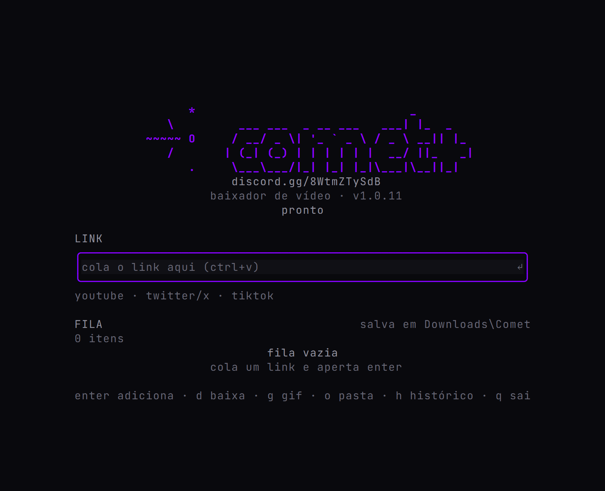

# ☄ Comet+

```
                          _        
  ___ ___  _ __ ___   ___| |_  _   
 / __/ _ \| '_ ` _ \ / _ \ __|| |_ 
| (_| (_) | | | | | |  __/ ||_   _|               -  video downloader
 \___\___/|_| |_| |_|\___|\__||_|  
```

Baixador de vídeos no terminal. Cola a URL, aperta Enter, pronto.



## Suporta

- YouTube (`youtube.com/watch`, `youtu.be`)
- Twitter/X — vídeo **e** GIF (`.gif` real via ffmpeg)
- TikTok (`tiktok.com/@user/video/…`)

## Uso

**Duplo clique no `comet.exe`** abre a janela: cola o link (Ctrl+V) e ele já começa
a baixar. Escolha vídeo, GIF ou MP3 antes de colar. Os arquivos vão para
`Downloads\Comet`.

**No terminal**, `comet` abre a versão de terminal (`comet --app` abre a janela).
Cole a URL (Ctrl+V) no campo e aperte **Enter**. Depois:

| Tecla | Ação |
|-------|------|
| `Enter` | Adiciona URL à fila |
| `D` | Baixa a fila |
| `G` | Alterna GIF no item selecionado (Twitter) |
| `M` | Alterna MP3 no item selecionado |
| `O` | Abre a pasta com o arquivo do item selecionado já marcado |
| `H` | Abre o histórico; `Enter` nele baixa de novo |
| `↑` / `↓` | Move a seleção |
| `Q` / `Esc` / `Ctrl+C` | Sai |

Teclas de comando só valem com o campo de URL vazio. Para digitar a URL à
mão, cole com Ctrl+V.

GIF do Twitter: selecione o item e aperte `G` antes de `D` — o vídeo vira
`.gif` de verdade (paleta otimizada via ffmpeg), não só um mp4 renomeado.

Twitter/X e TikTok pedem cookies: o Comet usa os cookies do Chrome, Edge ou
Brave instalados na máquina (`--cookies-from-browser`). Sem isso, a
plataforma bloqueia o download.

Os vídeos caem na pasta onde o terminal está: `cd Downloads` e depois `comet`
salva em Downloads. Aberto direto na pasta do usuário, com duplo clique no exe ou
num terminal de admin (System32), vai para `%USERPROFILE%\Downloads\Comet\`. A
pasta de destino aparece ao lado de FILA. O arquivo se chama `Comet - <título>`, e
link no texto do post sai do nome.

No primeiro uso, o Comet baixa `yt-dlp` e `ffmpeg` sozinhos para
`%LOCALAPPDATA%\comet\bin` (mostra o progresso na tela). Se `vendor\`
existir ao lado do exe, ele usa os binários de lá.

## Build

Requer [Rust](https://rustup.rs).

```
.\build.ps1
```

Gera `dist\comet.exe` e `dist\comet-v<versão>.zip` (versão lida do `Cargo.toml`).

## Testes

```
cargo test              # unitários
cargo test -- --ignored # download real de rede (~90 MB de vendor)
```

## Limitações

Posts que exigem login falham com a mensagem `vídeo privado ou pede login`.
O Comet não tem login por design. GIF de Twitter/TikTok vem
como `.mp4` do site; o `G` converte para `.gif` real.

## Licença

MIT — de Axolotl BR, para a internet.

Logo: o cometa é o Twemoji ☄ ([jdecked/twemoji](https://github.com/jdecked/twemoji)) —
créditos: © Twitter, X e colaboradores, licença CC-BY 4.0.
